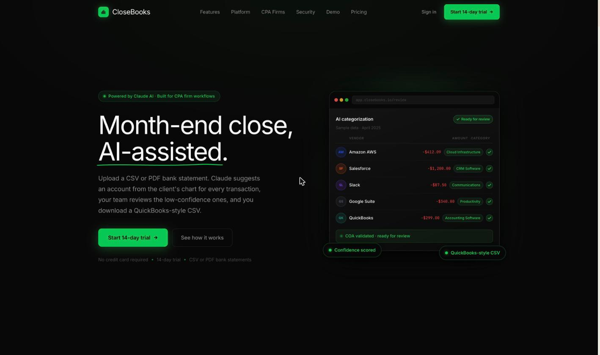
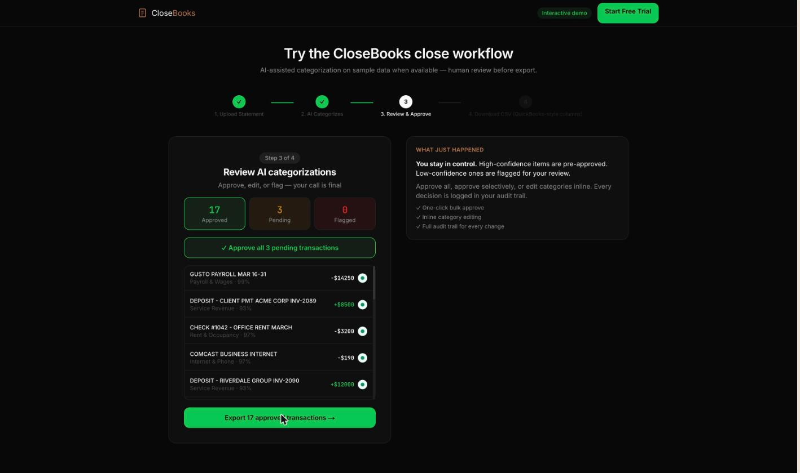

# closebooks

ai assisted month end close for small accounting firms. you upload a client's bank statement, claude suggests an account from that client's chart of accounts for each transaction, the accountant only reviews the ones it isn't sure about, then you export a quickbooks style csv.

demo (no account, sample data): https://closebooks-app.vercel.app/demo



## why

a lot of month end at small firms is someone reading stuff like `AMZN*MKT*7H3K9` and deciding which account it goes to, one line at a time. it's repetitive and easy to get wrong.

## how it works

```
bank statement (csv / pdf)
  -> parser          clean transactions out of messy bank exports
  -> firm rules      vendor rules saved from past corrections run first
  -> claude          suggests an account + confidence + reasoning
  -> coa check       suggestion has to be a real account in the client's chart
  -> review queue    low confidence / invalid rows wait for a human
  -> export          quickbooks style csv, plain csv, printable close report
```



a few decisions:
- nothing exports until every row is approved. anything under 93% confidence (default) or that doesn't match the chart goes to review. the ai suggests, the accountant decides
- when someone fixes a category they can save it as a rule (`DoorDash*` -> meals). rules run before the model next time, and recent fixes get passed to the model as hints
- the chart of accounts check is there because llms will happily suggest an account that sounds right but doesn't exist in that client's books
- each firm's data is separated with row level security

also: multi client workspace, bulk approve + undo, stripe billing with a 14 day trial. runs on vercel with the anthropic api.

## status

early, live as a demo, no paying customers yet. co-founded with ilia duda. the main codebase is private, this repo is the overview. happy to walk through the code.
